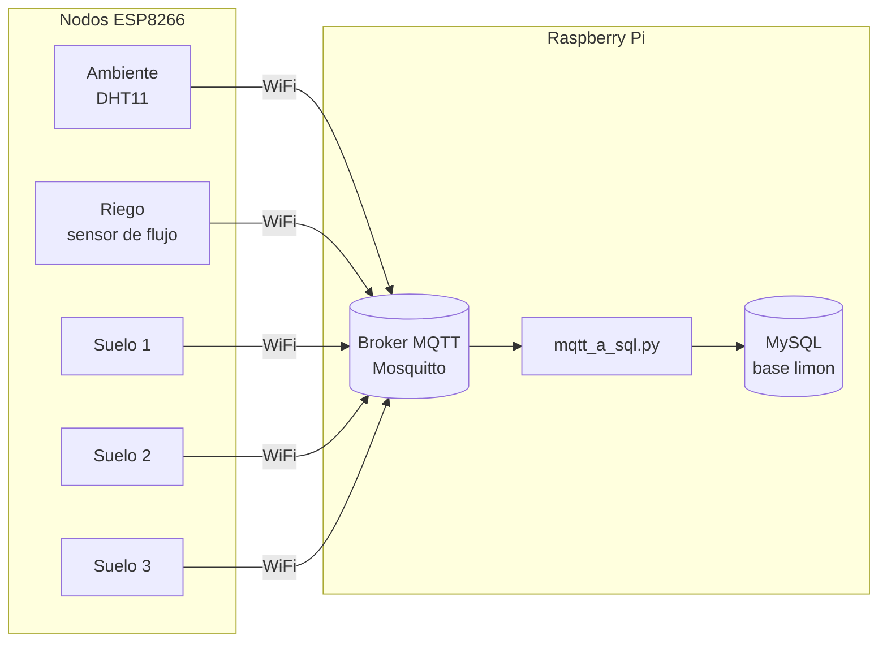
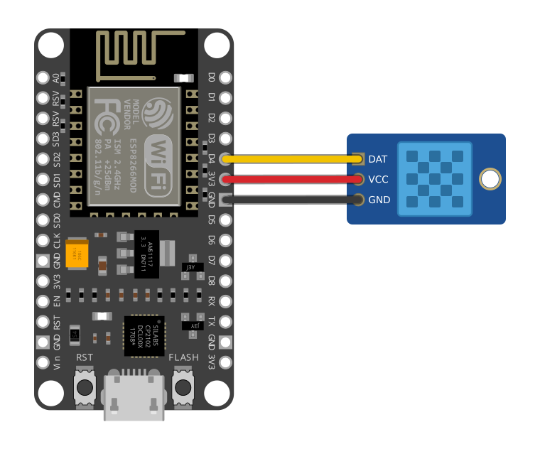
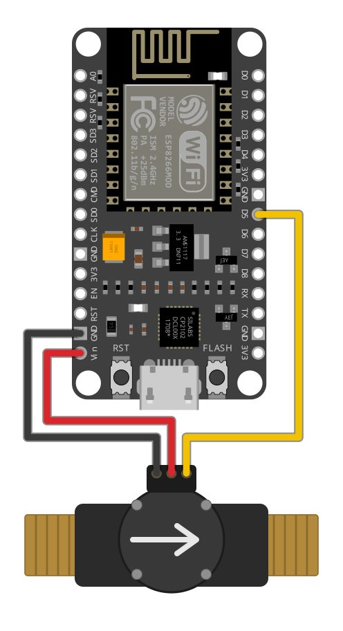
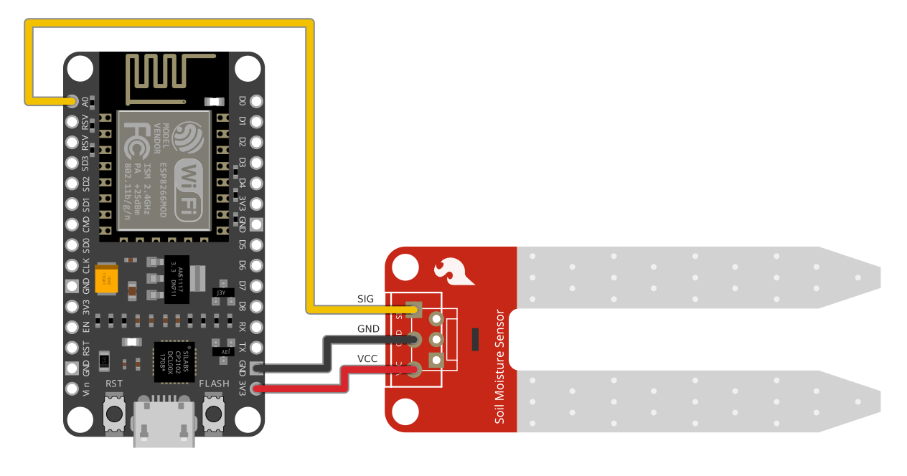

# Monitoreo de un árbol de limón

Sistema para vigilar las condiciones de un árbol de limón: temperatura y humedad del aire, humedad del suelo en tres puntos y agua de riego. Varios nodos ESP8266 leen los sensores y publican las lecturas por MQTT; una Raspberry Pi las recibe y las guarda en una base de datos.

Es un proyecto de la universidad, de 2024, reordenado después para que se pueda volver a montar.

## Cómo funciona



Cada nodo publica cada 30 segundos:

| Nodo | Sensor | Pin | Tema MQTT | Valor |
|---|---|---|---|---|
| Ambiente | DHT11 | D4 | `limon/temperatura` | Temperatura del aire, en °C |
| | | | `limon/humedad` | Humedad relativa del aire, en % |
| Riego | Sensor de flujo de pulsos | D5 | `limon/volumen` | Litros que pasaron desde la publicación anterior |
| Suelo 1 | Sensor analógico de humedad | A0 | `limon/suelo` | Humedad del suelo, en % |
| Suelo 2 | Sensor analógico de humedad | A0 | `limon/suelo2` | Humedad del suelo, en % |
| Suelo 3 | Sensor analógico de humedad | A0 | `limon/suelo3` | Humedad del suelo, en % |

El programa de la Raspberry Pi guarda cada lectura con la hora de llegada:

| Tabla | Columnas | Viene de |
|---|---|---|
| `Temperatura` | `time`, `HumedadA`, `Temperatura` | `limon/humedad` y `limon/temperatura`, juntas en una fila |
| `Flujo` | `time`, `Litros` | `limon/volumen` |
| `Suelo`, `Suelo2`, `Suelo3` | `time`, `Humedad` | `limon/suelo`, `limon/suelo2`, `limon/suelo3` |

## Conexiones

Los pines salen del código. La alimentación de cada sensor es la habitual para ese tipo de módulo: conviene comprobarla con el sensor que se tenga.

**Ambiente**



| DHT11 | NodeMCU | Cable |
|---|---|---|
| DAT | D4 | Amarillo |
| VCC | 3V3 | Rojo |
| GND | GND | Negro |

**Riego**



| Sensor de flujo | NodeMCU | Cable |
|---|---|---|
| Pulsos | D5 | Amarillo |
| Positivo | VIN (5 V) | Rojo |
| Negativo | GND | Negro |

Estos sensores suelen alimentarse a 5 V y entonces su señal también sale a 5 V. Las entradas del ESP8266 son de 3.3 V: lo seguro es bajar la señal con un divisor de dos resistencias antes de D5. El diagrama muestra la conexión directa, que es la que corresponde al programa original.

**Suelo**



| Sensor de suelo | NodeMCU | Cable |
|---|---|---|
| SIG | A0 | Amarillo |
| VCC | 3V3 | Rojo |
| GND | GND | Negro |

Los tres nodos de suelo se conectan igual; cambia solo el tema en el que publica cada uno.

Los diagramas los dibuja `docs/conexiones/generar.py`, que coloca las piezas de `docs/conexiones/piezas/` y traza los cables entre sus pines:

```sh
python docs/conexiones/generar.py
```

Las ilustraciones de la NodeMCU y del sensor de suelo vienen de la biblioteca de piezas de [Fritzing](https://fritzing.org), con licencia [CC BY-SA 3.0](https://creativecommons.org/licenses/by-sa/3.0/). El sensor de suelo dibujado es el de esa biblioteca y hace de sustituto del que se usó, que era de otro modelo pero con los mismos tres pines.

## Nodos

El programa de los nodos está en `firmware/` y es uno solo: al compilar se elige qué sensor lleva. Se compila con [PlatformIO](https://platformio.org/).

1. Copia `firmware/include/secretos.ejemplo.h` como `secretos.h` y pon el nombre y la clave de la red WiFi, la dirección de la Raspberry Pi y el usuario del broker.
2. Conecta la placa y sube el programa del nodo que toque:

```sh
cd firmware
pio run -e ambiente -t upload
pio run -e flujo -t upload
pio run -e suelo1 -t upload   # suelo2 y suelo3 para los otros dos
```

Está preparado para una placa NodeMCU. Para otra placa con ESP8266 cambia `board` en `platformio.ini`.

### Ajustes

Están en `firmware/include/config.h`:

- `PERIODO_MS`: cada cuánto se publica.
- `PULSOS_POR_LITRO`: depende del sensor de flujo; viene en su hoja de datos.
- `SUELO_SECO` y `SUELO_MOJADO`: la lectura del sensor de suelo al aire y dentro del agua. El programa escribe la lectura por el puerto serie; con esos dos valores el porcentaje queda calibrado. Sin tocarlos se usa la escala completa del convertidor, que es lo que hacía el proyecto original.

## Servidor

En la Raspberry Pi hacen falta un broker MQTT (Mosquitto) y MySQL o MariaDB.

```sh
cd servidor
sudo mysql < esquema.sql                 # crea la base `limon` y sus tablas
python3 -m venv .venv
.venv/bin/pip install -r requirements.txt
cp .env.ejemplo .env                     # y pon los datos del broker y de la base
.venv/bin/python mqtt_a_sql.py
```

Para que arranque con el sistema está `monitoreo-arbol.service`; las instrucciones van dentro del archivo.

### Probarlo sin hardware

`servidor/local/` trae un broker y una base de datos en contenedores, y un programa que publica lecturas inventadas como lo harían los nodos:

```sh
cd servidor/local
docker compose up -d
cd ..
cp .env.ejemplo .env
.venv/bin/python mqtt_a_sql.py &
.venv/bin/python local/simular_nodos.py --ciclos 3 --periodo 2
```

Las pruebas de la parte que convierte los mensajes en filas se corren con `python -m pytest pruebas`.

## Cambios respecto a la versión original

La primera versión eran tres programas de Arduino casi iguales y un guion de Python. Al reordenarla se corrigió esto:

- Las claves de la red, del broker y de la base de datos estaban escritas en el código. Ahora van en archivos aparte que no se suben.
- Los nodos de riego y de suelo se presentaban al broker con el mismo nombre, y el broker desconectaba a uno cada vez que entraba otro. Ahora cada placa usa su número de serie.
- El nodo de suelo se quedaba detenido 30 segundos entre lecturas, más de lo que el broker espera sin noticias, y perdía la conexión en cada ciclo. Ahora ningún nodo se detiene.
- El agua de riego se guardaba en una columna llamada `LpH` (litros por hora), pero el valor eran los litros de cada intervalo. La columna pasa a llamarse `Litros`.
- Si se perdía la conexión con la base de datos, el programa dejaba de guardar. Ahora la vuelve a abrir.
- Los mensajes que no traen un número se descartan en vez de detener el programa.

## Lo que falta

- Los datos que se midieron en su momento y la forma en que se graficaban no están en el repositorio.
- Los modelos exactos de los sensores de flujo y de suelo.

## Licencia

El código se publica con la licencia [MIT](LICENSE). Los diagramas de `docs/conexiones/` usan ilustraciones de Fritzing y se publican con la licencia CC BY-SA 3.0, que es la de esas ilustraciones.
